<picture>
  <source media="(prefers-color-scheme: dark)" srcset="./assets/header-dark.svg">
  
</picture>

<a href="https://portfolio-eight-olive-24.vercel.app">Portfolio ↗</a>

製造業の現場と、エンジニアと、経営のあいだを訳して、プロダクトにしています。 
研究の厳密さと、プロダクトのスピードと、ものづくりの遊び心を、ひとつの手の中に。

 

### Now

**ARCHAIVE** &nbsp;—&nbsp; 図面・BOM・見積・発注実績をひとつにまとめ、AI エージェントで社内の情報を探せる製造業向けプラットフォーム。プロダクトマネージャーとして、ロードマップ・要件定義・UX を持っています。

**How I run product** &nbsp;—&nbsp; Epic を頂点にした 2 層のロードマップ、仕様駆動開発、隔週リリースのバグチェック会。

**AI as a colleague** &nbsp;—&nbsp; Claude Code の自作スキル約 20 個と MCP で、議事録から CRM への連携、要望のトリアージ、リリースのチェックリストづくりを仕組みにしています。

 

<picture>
  <source media="(prefers-color-scheme: dark)" srcset="./assets/works-dark.svg">
  
</picture>

<a href="https://starup-hp.vercel.app">STARUP Corporate Site ↗</a> &nbsp;·&nbsp; <a href="https://portfolio-eight-olive-24.vercel.app">Portfolio ↗</a>

 

<picture>
  <source media="(prefers-color-scheme: dark)" srcset="./assets/toolkit-dark.svg">
  
</picture>

 

<picture>
  <source media="(prefers-color-scheme: dark)" srcset="./assets/timeline-dark.svg">
  
</picture>

 

<i>眠らぬうさぎには、誰も勝てない。</i>

